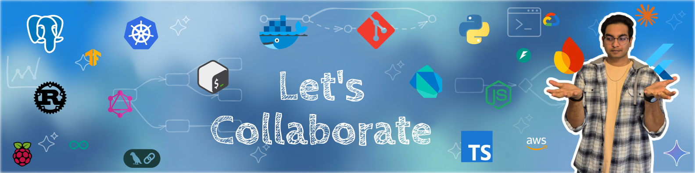

<div align="center">


<br><br>


Building **production-grade software systems end-to-end**, from polished<br>
Flutter frontends to scalable backends and AI-powered pipelines.

**10K+ users · 99.8% uptime · 40% latency reduction · 40% crash reduction**

> I believe great engineering is where **architecture, performance, and product sense** meet.

[](https://yashashm.medium.com/)
&nbsp;
[](https://github.com/yashas-hm/talks)
&nbsp;
[](https://yashashm.dev/contributions)

</div>

### 🌟 Highlights

My work focuses on **shipping real products**, not demos:

- AI systems that care about **latency, reliability, and inference**
- Backend services that scale cleanly
- Mobile apps that feel fast, intentional, and human
- Infrastructure that is scalable, reliable, and secure

---

### 🔍 What I work on

| Area                       | Focus                                                    |
|:---------------------------|:---------------------------------------------------------|
| 🧠 **AI Systems**          | RAG pipelines, LangChain, LLM integration, vector search |
| ⚙️ **Backend Engineering** | FastAPI, Node.js, REST APIs, scalable data models        |
| 📱 **Mobile & Frontend**   | Flutter apps with clean architecture and smooth UX       |
| 🏗️ **Infrastructure**      | Dockerized deployments, CI/CD, cloud-native systems      |
| 👁️ **Applied ML**          | Computer vision, on-device ML, inference optimization    |

---

### 👀 Things I know

|                        |                                                                                                                                                                                                                                                                                                                                                                                                                                                                                                                                                                                                                                                                                                                                                                                                                                                                                                                                                                                                                                                                                |
|:-----------------------|:-------------------------------------------------------------------------------------------------------------------------------------------------------------------------------------------------------------------------------------------------------------------------------------------------------------------------------------------------------------------------------------------------------------------------------------------------------------------------------------------------------------------------------------------------------------------------------------------------------------------------------------------------------------------------------------------------------------------------------------------------------------------------------------------------------------------------------------------------------------------------------------------------------------------------------------------------------------------------------------------------------------------------------------------------------------------------------|
| **Languages**          |          |
| **Front-End**          |                                                                                                                                                                                                                                                                                                                                                                                                                                                                                                                                                                                                           |
| **Back-End**           |                                                                                                                                                                                                                                                                                                                                                                                                                                                                                                                                                                                |
| **Database**           |                                                                                                                                                                                                                                                                                                                                                                                                                                                         |
| **ML / AI**            |                                                                                                                                                                                                                                                                                                                                                                                                                                                                               |
| **DevOps**             |                                                                                                                                                                                                                                                                                                                                                                                                                                        |
| **Cloud**              |                                                                                                                                                                                                                                                                                                                                                                                                                                                                                                                                                                                                                                                                                                                                                                                                                                                           |
| **Version Control**    |                                                                                                                                                                                                                                                                                                                                                                                                                                                                                                                                                                                                                                                                                                                                                                                                                                                   |
| **Internet of Things** |                                                                                                                                                                                                                                                                                                                                                                                                                                                                                                                                                                                                                                                                                                    |
| **Other**              |                                                                                                                                                                                                                                                                                                                                                                                |

---

### 🌱 Current Focus

```diff
+ Designing AI-native application architectures
+ Improving LLM inference performance & retrieval pipelines
+ Building systems that are boring to deploy and exciting to use
+ Research on VR Haptics
```

---

### 📫 Connect with me

[](https://yashashm.dev)&nbsp;
[](mailto:yashashm.dev@gmail.com)
&nbsp;
[](https://www.linkedin.com/in/yashashm)
&nbsp;
[](https://twitter.com/YashasMajmudar)

---

### 🎤 Outside of code

I sing too because engineering needs rhythm 🎶<br>
[](https://linktr.ee/yashashm)
